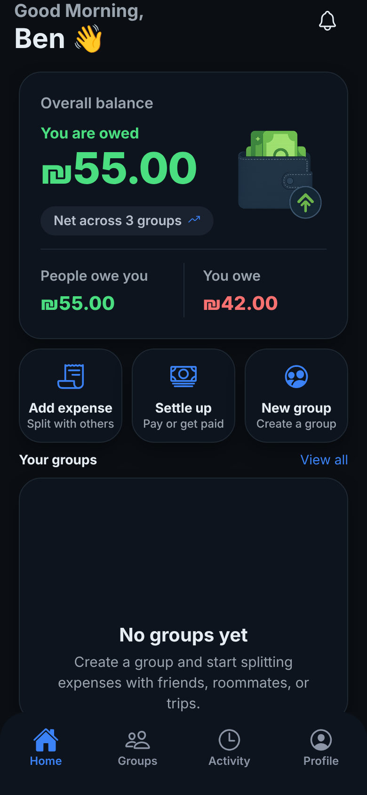
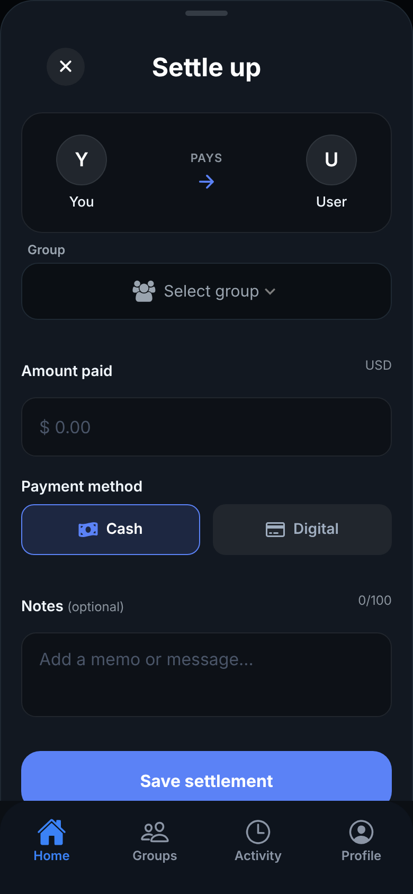
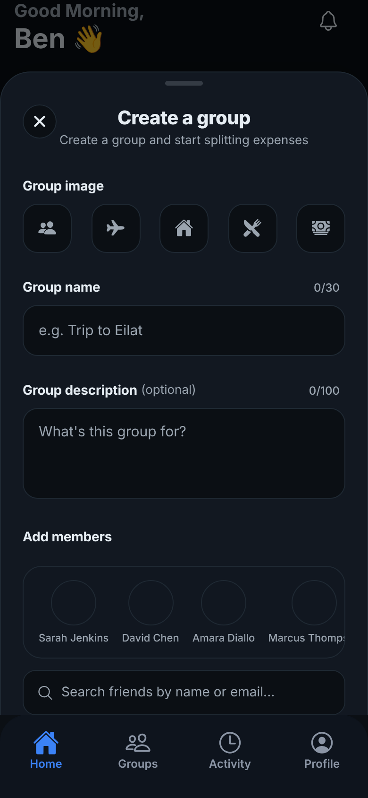
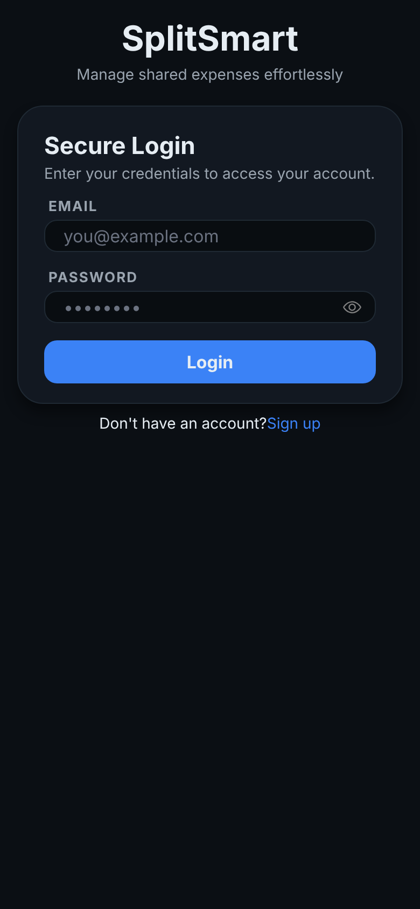
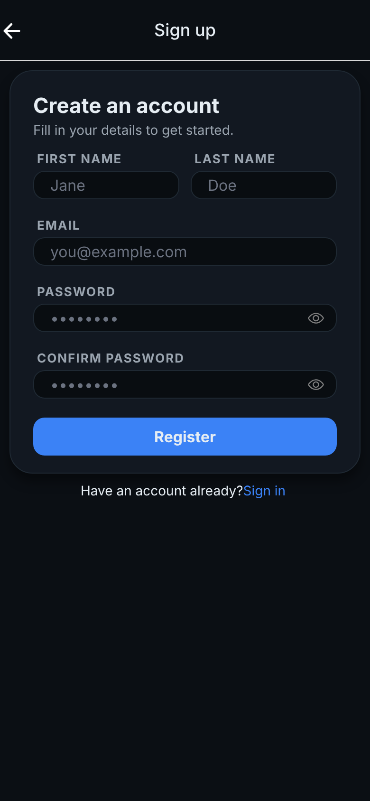

<div align="center">

# 💸 SplitSmart

**A dark-themed, mobile-first expense-sharing app — split bills, track balances, settle up.**


<br/>


&nbsp;&nbsp;

&nbsp;&nbsp;


</div>

---

## ✨ Overview

SplitSmart is a full-stack TypeScript monorepo: an **Expo / React Native** client and a **NestJS + PostgreSQL** API. It's built around the everyday "who owes whom?" problem — shared apartments, lunch crews, trips — with a polished UI and a typed, validated data layer from day one.

The client is the most developed part today: a complete design system, authentication flow and the three core money flows (add expense, settle up, create group) are in place and running. Wiring them to the backend is the current focus.

## 📱 Screens

| Login | Sign up |
| :---: | :---: |
|  |  |
| Email + password with inline validation and a show/hide toggle | Two-column name row, confirm-password check, live error messages |

| Home dashboard | Settle up | Create a group |
| :---: | :---: | :---: |
|  |  |  |
| Time-aware greeting, overall balance card with *you're owed / you owe* split, quick actions, animated empty state | Payer → payee summary, group picker, amount, cash/digital toggle, character-counted notes | Icon picker, name & description with live counters, friend selector with search |

## 🎯 Highlights

**Product & UX**
- 🌙 **Cohesive dark design system** — a single typed `theme` token file (surfaces, text, semantic money colors, tabs, pills) drives every component, so the whole app restyles from one place.
- 🟢🔴 **Semantic money colors** — green for what you're owed, red for what you owe, at a glance.
- 🧾 **Three core flows as bottom sheets** — *Add expense*, *Settle up* and *Create group* slide up over the dashboard (`@gorhom/bottom-sheet`) instead of pushing new screens, keeping context.
- 👋 **Time-of-day greeting**, Lottie empty states and a rounded custom tab bar for a native feel.
- ₪ **ILS currency** as a first-class type, with Hebrew-friendly group data in the mocks.

**Engineering**
- 🧩 **Schema-first forms** — [`react-hook-form`](https://react-hook-form.com) + [`zod`](https://zod.dev) schemas (`signUpSchema`, `loginSchema`, `createGroupSchema`, `addExpenseSchema`) with cross-field refinement (password match) and inferred input/output types.
- 🗂️ **File-based routing** with Expo Router, an auth gate on launch, and a tabbed shell (Home · Groups · Activity · Profile).
- 🔐 **Secure token storage** — `expo-secure-store` on device, with a web fallback; JWT issued by the API.
- 🧱 **Reusable component library** — `Button`, `CustomInput`, `OverallBalanceCard`, `ActivityCard`, `GroupRow`, `GroupsOverviewCard`, `MissingDataCard`, …
- 🛡️ **Backend foundations** — NestJS modules for Auth and Users, `bcrypt` password hashing, JWT via Passport, DTO validation with `class-validator` (`whitelist` + `forbidNonWhitelisted`), TypeORM entities on PostgreSQL, Docker Compose for the database.

## 🧱 Architecture

```
splitsmart/
├─ apps/
│  ├─ mobile/                 # Expo (React Native) client
│  │  ├─ app/                 # Expo Router: auth/, (tabs)/
│  │  ├─ components/          # auth forms + reusable UI + bottom-sheet flows
│  │  ├─ constants/           # theme tokens, icons, data shapes, mocks
│  │  ├─ schemas/             # zod validation schemas
│  │  └─ src/api/             # API client + secure token helpers
│  ├─ api/                    # NestJS REST API
│  │  └─ src/{auth,users}/    # JWT auth, DTOs, TypeORM entities
│  └─ docker-compose.yml      # PostgreSQL 15
└─ pnpm-workspace.yaml        # pnpm monorepo
```

## 🛠️ Tech stack

| Layer | Tools |
| --- | --- |
| Mobile | Expo 54, React Native 0.81, React 19, Expo Router, Reanimated 4, Gesture Handler, Bottom Sheet, Lottie |
| Forms & validation | react-hook-form, zod |
| Backend | NestJS 11, Passport + JWT, bcrypt, class-validator / class-transformer |
| Data | PostgreSQL 15, TypeORM |
| Tooling | pnpm workspaces, TypeScript 5, ESLint, Prettier, Jest, Docker Compose |

## 🚀 Getting started

**Prerequisites:** Node 20+, [pnpm](https://pnpm.io), Docker (for Postgres), and the Expo Go app or an emulator.

```bash
# 1. install
pnpm install

# 2. configure the API — create apps/api/.env
#    DATABASE_HOST=localhost
#    DATABASE_PORT=5432
#    DATABASE_USER=...   DATABASE_PASS=...   DATABASE_NAME=...
#    JWT_SECRET=...      PORT=3000

# 3. start Postgres
cd apps && docker-compose --env-file api/.env up -d && cd ..

# 4. run the API and the app (two terminals)
pnpm dev:api
pnpm dev:mobile
```

> On a physical device, set `API_HOST` to your machine's LAN IP so the app can reach the API.

## 🗺️ Roadmap

- [x] Monorepo setup (pnpm workspaces, Expo + NestJS)
- [x] Design system & reusable component library
- [x] Login / sign-up UI with schema validation
- [x] Register & login API with hashed passwords and JWT
- [x] Home dashboard, Add expense, Settle up and Create group flows (UI)
- [ ] Persist groups, expenses and settlements (TypeORM entities + endpoints)
- [ ] Equal / custom split engine and per-group balances
- [ ] Debt simplification ("settle in the fewest payments")
- [ ] Groups, Activity and Profile tabs
- [ ] Push notifications and receipt photos
- [ ] CI, e2e tests and production deployment

## 📌 Project status

SplitSmart is under active development. The UI layer and authentication are working end-to-end; the money flows currently run against mock data while the backend domain model is being built. Screenshots above are captured from the running app.

## 📄 License

Personal portfolio project. All rights reserved.
